# InterviewGuide 项目架构全景

> 本文基于源码实读整理，目标是"看完图就能讲清楚这个系统怎么跑"。所有图均为 Mermaid，可在支持 Mermaid 的 Markdown 预览器中直接渲染。
>
> 项目根目录：`interview-guide/`；后端 `app/`，前端 `frontend/`，编排与配置在根目录。
> 核实范围：`app/src/main/java` 251 个 Java 文件、`frontend/src`、`app/src/main/resources`、`docker-compose*.yml`、`application*.yml`。

**关于看图**：本文 29 张图已用 Mermaid 官方解析器（v11）逐张验证通过，并在真实浏览器中全部成功渲染。若某个 Markdown 预览器报 `Parse error on line 1 ... Expecting 'NEWLINE', 'SPACE', 'GRAPH', got 'ALPHA'`，通常是该预览器把代码块里的换行压成了空格（Mermaid 要求 `flowchart LR` 之后必须是换行），并非本文语法有误。此时请打开同目录的 **`项目架构-图表.html`**：图已预先渲染成内嵌 SVG，完全离线可看、不依赖预览器是否支持 Mermaid；也可改用支持 Mermaid 的查看器（VS Code + Mermaid 插件、Typora、GitHub 等）。

---

## 0. 一页速览

**一句话**：这是一个"单 Spring Boot 单体 + React SPA"的 AI 面试平台，用 PostgreSQL/pgvector 同时承担业务库与向量库，用 Redis 同时承担缓存、限流、会话租约和 **5 条异步任务队列**，所有 LLM 能力通过统一的多 Provider 注册中心动态构建，对外只暴露一个 REST 端口和一个 WebSocket 端点。

| 维度 | 结论 |
| --- | --- |
| 后端 | Spring Boot 4.1 / Java 21（虚拟线程）/ Gradle 8.14 / Spring AI 2.0 |
| 前端 | React 18 + TypeScript 5.6 + Vite 5 + Tailwind 4 + React Router 7 |
| 数据 | PostgreSQL 16 + pgvector（HNSW / COSINE / 1024 维）、Flyway V1~V7 管理 19 张业务表（18 个 JPA 实体 + 1 张多对多中间表） |
| 中间件 | Redis 7 + Redisson 4： 缓存、Redis Stream、Lua 滑动窗口限流、验证码、WS Ticket、语音会话租约 |
| 文件 | S3 兼容对象存储：生产 MinIO、开发 RustFS；Apache Tika 解析；iText 8 导出 PDF |
| 外部 AI | DashScope（Chat / Embedding / Qwen3 ASR / Qwen3 TTS），另支持 Kimi / DeepSeek / GLM / LM Studio 等 OpenAI 兼容 Provider |
| 业务模块 | auth、resume、interview、interviewschedule、knowledgebase、llmprovider、voiceinterview（7 个） |
| 入口 | REST `9 个 @RestController` + WebSocket `/ws/voice-interview/{sessionId}` |
| 部署 | `docker-compose.yml` 6 服务（Nginx 前端、后端、PG、Redis、MinIO、Bucket 初始化） |

### 图索引

| # | 图类型 | 内容 |
| --- | --- | --- |
| 1 | 架构图 | 系统总体容器架构 |
| 2 | 架构图 | 后端包结构与模块地图 |
| 3 | 流程图 | 一次 HTTP 请求的完整处理链 |
| 4 | ER 图 | 核心业务实体关系 |
| 5 | 时序图 | 手机号验证码登录 + 双 Token 下发 |
| 6 | 流程图 | JWT 鉴权与多租户数据隔离 |
| 7 | 架构图 | Redis Stream 异步任务框架（5 条队列） |
| 8 | 状态图 | 异步任务状态机 |
| 9 | 流程图 | `AbstractStreamConsumer` 消费流程 |
| 10 | 时序图 | 简历上传 → 异步分析 → 轮询 → PDF 导出 |
| 11 | 流程图 | 简历分析去重与解析分支 |
| 12 | 流程图 | 知识库文档上传与向量化 |
| 13 | 流程图 | RAG 检索与问答生成 |
| 14 | 时序图 | RAG 会话 SSE 流式问答 |
| 15 | 流程图 | Skill 驱动出题流程 |
| 16 | 状态图 | 文字面试会话状态机 |
| 17 | 时序图 | 统一评估引擎（文字 / 语音共用） |
| 18 | 架构图 | 语音面试组件与协议 |
| 19 | 时序图 | WebSocket 一次性票据握手 |
| 20 | 时序图 | 语音面试一轮对话（ASR → LLM → TTS） |
| 21 | 状态图 | 语音面试阶段推进状态机 |
| 22 | 状态图 | 语音面试会话生命周期状态机 |
| 23 | 架构图 | 多模型 Provider 与 AI 治理 |
| 24 | 流程图 | 限流切面 + Lua 滑动窗口 |
| 25 | 流程图 | 资源删除补偿机制 |
| 26 | 部署图 | Docker Compose 生产编排 |
| 27 | 流程图 | 配置来源与优先级 |
| 28 | 流程图 | 前端路由与页面结构 |
| 29 | 时序图 | 401 Access Token 刷新 |

共 29 张图，覆盖**架构图、流程图、时序图、状态图、ER 图、部署图**六类视角。

---

## 1. 系统总体架构

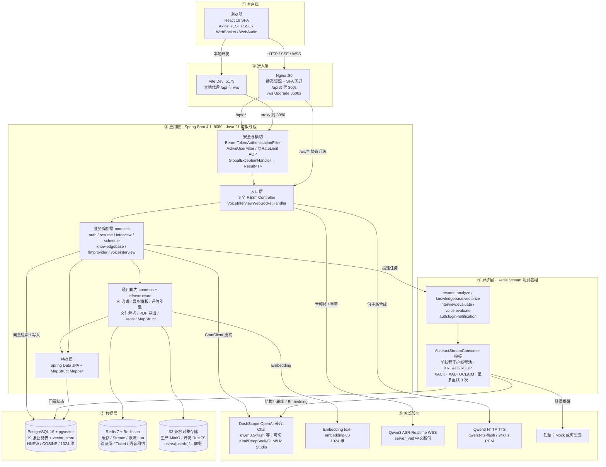

**架构取舍**：没有引入 Kafka / 独立向量库 / 微服务。PG + pgvector 让关系数据与向量数据同库同事务；Redis 一个组件同时覆盖缓存、消息队列、限流、分布式协调，运维面收敛到一个 Spring Boot 进程 + 三个依赖服务。

---

## 2. 后端包结构与模块地图

```mermaid
flowchart LR
  APP["App.java<br/>@SpringBootApplication<br/>排除 6 个 Spring AI OpenAI 自动配置<br/>@EnableScheduling"]

  subgraph LAYER1["modules · 178 个类 · 业务域"]
    AUTH["auth 40<br/>登录 / JWT / 设备 / 租户"]
    RESUME["resume 17<br/>上传 / 分析 / 历史"]
    INTERVIEW["interview 27<br/>Skill 出题 / 答题 / 评估"]
    SCHEDULE["interviewschedule 11<br/>邀约解析 / 日历"]
    KB["knowledgebase 34<br/>文档 / 向量 / RAG 会话"]
    LLM["llmprovider 17<br/>Provider / 语音配置"]
    VOICE["voiceinterview 32<br/>WebSocket / ASR / TTS"]
  end

  subgraph LAYER2["common · 56 个类 · 通用能力"]
    AI["ai 14<br/>Registry / 结构化输出 / 熔断 / 防注入"]
    ASYNCC["async 2 + constant 2<br/>Stream 生产者/消费者模板"]
    EVAL["evaluation 4<br/>统一评估引擎"]
    ASP["aspect 1 + annotation 1<br/>@RateLimit 可重复注解"]
    CFG["config 11 / service 8<br/>CORS / S3 / 资源清理补偿"]
    BASE["result 1 / exception 4<br/>Result&lt;T&gt; / BusinessException"]
  end

  subgraph LAYER3["infrastructure · 16 个类 · 技术基础设施"]
    FILE["file 9<br/>Tika / 哈希 / 校验 / S3 / 清洗"]
    REDISC["redis 2<br/>RedisService / InterviewSessionCache"]
    EXPORT["export 1<br/>iText 8 PDF"]
    MAPPER["mapper 4<br/>MapStruct"]
  end

  APP --> LAYER1
  APP --> LAYER2
  APP --> LAYER3
  LAYER1 -->|"依赖方向"| LAYER2
  LAYER1 -->|"依赖方向"| LAYER3
  LAYER2 --> LAYER3
```

**分层约定（`AGENTS.md`）**：`Controller → Service → Repository`；Controller 只做路由/校验/委托；`@Transactional` 只在 Service 层且范围最小；LLM、S3、外部 HTTP **不得放在数据库事务内**；对外统一 `Result<T>`，禁止直接返回 Entity；基础设施能力下沉到 `common/` 或 `infrastructure/`。

### 一次 HTTP 请求的完整处理链

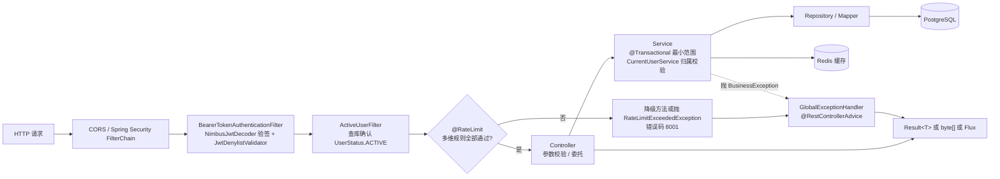

---

## 3. 功能模块与 API 全景

| 模块 | 主要入口 | 关键端点（摘录） |
| --- | --- | --- |
| auth | `AuthController` `/api/auth` | `/sms/send`、`/login/sms`、`/refresh`、`/logout`、`/me`、`/ws-ticket` |
| resume | `ResumeController` | `POST /api/resumes/upload`、`GET /api/resumes`、`/{id}/detail`、`/{id}/export`、`/{id}/file`、`/{id}/reanalyze` |
| interview | `InterviewController` | `/api/interview/sessions`（列表/创建）、`/question`、`/answers`、`/report`、`/export`、`/complete`、`/details` |
| interview·skill | `InterviewSkillController` | `GET /api/interview/skills`、`POST /api/interview/skills/parse-jd` |
| interviewschedule | `InterviewScheduleController` | `POST /parse`、CRUD `/api/interview-schedule`、`/{id}/status` |
| knowledgebase | `KnowledgeBaseController` | `/upload`、`/query`、`/query/stream`、`/revectorize`、`/stats`、`/download`、`/categories` |
| knowledgebase·rag | `RagChatController` | `/api/rag-chat/sessions` 会话 CRUD、置顶、关联知识库、`/messages/stream` |
| llmprovider | `LlmProviderController`（**ADMIN**） | `/api/llm-provider` Provider CRUD、默认模型切换、`/voice/asr`、`/voice/tts`、`/reload` |
| voiceinterview | `VoiceInterviewController` | `/api/voice-interview/sessions` 创建/暂停/恢复/结束/评估、WebSocket `/ws/voice-interview/{sessionId}` |

**三类特殊返回**：SSE 端点 2 个（`/api/knowledgebase/query/stream` 返回 `Flux<String>`、`/api/rag-chat/sessions/{id}/messages/stream` 返回 `Flux<ServerSentEvent<String>>`）；PDF 下载端点 2 个（直接 `ResponseEntity<byte[]>`，不套 `Result`）；WebSocket 端点 1 个。

---

## 4. 数据架构

### 4.1 核心实体关系图

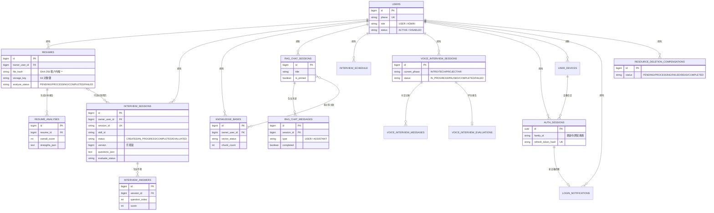

> 说明：`vector_store` 是 Spring AI pgvector 维护的**非 JPA 表**，向量 metadata 里带 `user_id`、`kb_id`、`doc_id`、`chunk_index` 等字段；`llm_provider_config` / `llm_global_setting` 无 JPA 关联，以字符串 ID 逻辑引用；`voice_interview_*` 的 `session_id`、`resume_id` 是裸 Long 列，没有外键。


### 4.2 数据分布与迁移

| 存储 | 放什么 |
| --- | --- |
| PostgreSQL | 19 张业务表 + `vector_store`；Flyway `V1` 基线 14 张表、`V2` 认证 4 张表与 `owner_user_id` 多租户、`V3` 删除补偿表、`V4` `evaluate_attempt`、`V5` 重试调度、`V6` 乐观锁 `version`、`V7` 性能索引 |
| Redis | 面试会话缓存（24h）、验证码与冷却/日限、JWT 黑名单 `auth:jwt:deny:{jti}`、WS 一次性 Ticket、语音租约 `voice:interview:lease:{sessionId}`、限流 ZSET、5 条 Stream |
| S3 | 原文件，键格式 `users/{ownerUserId}/resumes|knowledgebases/{yyyy/MM/dd}/{uuid8}_{拼音安全文件名}` |
| 用户目录 | 运行时 Provider 配置可写 `~/.interview-guide/`；API Key 加密落库（`api_key_ciphertext` + `nonce`） |

---

## 5. 认证与多租户隔离

### 5.1 手机号验证码登录时序

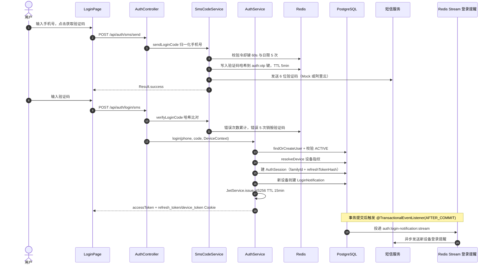

**关键 Redis Key**：`auth:otp:{phone}:code / cooldown / daily:{date} / attempts`、`auth:jwt:deny:{jti}`、`auth:ws-ticket:{sha256}`。

### 5.2 鉴权与租户隔离流程

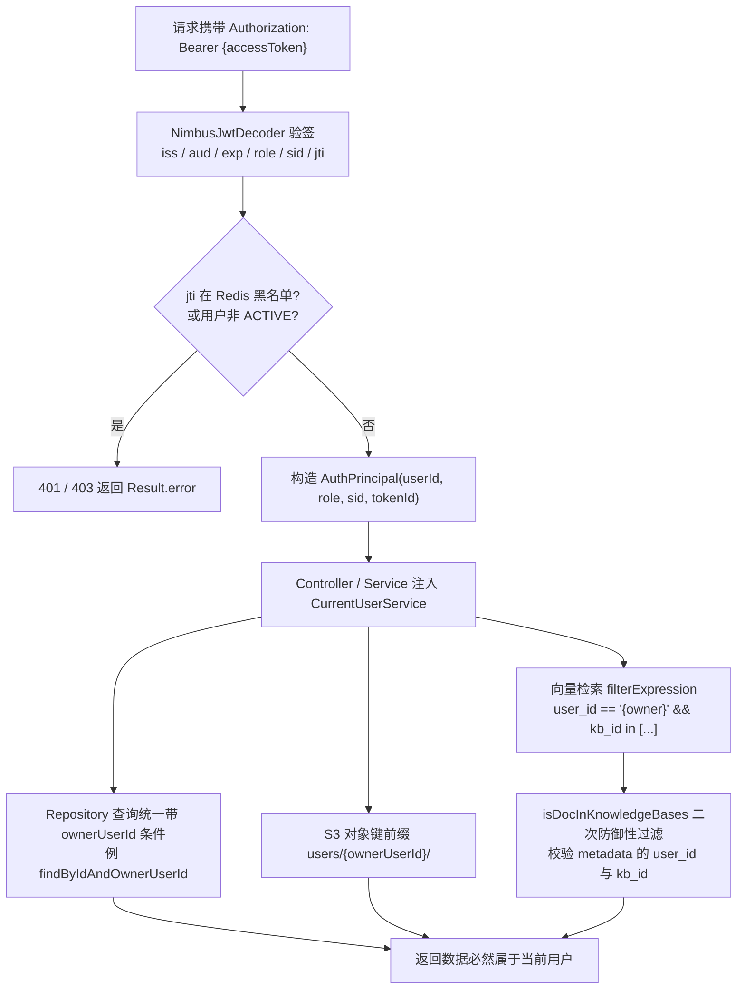

> 双 Token：Access Token 15 分钟放内存，Refresh Token 30 天放 `HttpOnly` Cookie，支持**轮换族失效**（`familyId` + `replacedBySessionId` + 30s 复用宽限）；登出把 `jti` 写入黑名单直到过期。

---

## 6. Redis Stream 异步任务框架

### 6.1 队列全景

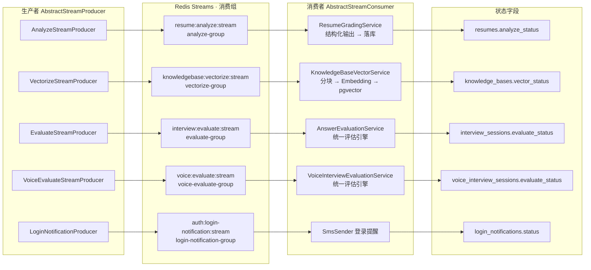

**通用常量**：`MAX_RETRY_COUNT=3`、`BATCH_SIZE=10`、`POLL_INTERVAL_MS=1000`、`PENDING_IDLE_TIMEOUT_MS=5min`、`STREAM_MAX_LEN=1000`（近似裁剪）。每个消费者是**单线程守护线程池**，`consumerName = 前缀 + UUID8`，启动时 `XGROUP CREATE`（BUSYGROUP 视为已存在）。

### 6.2 异步任务状态机

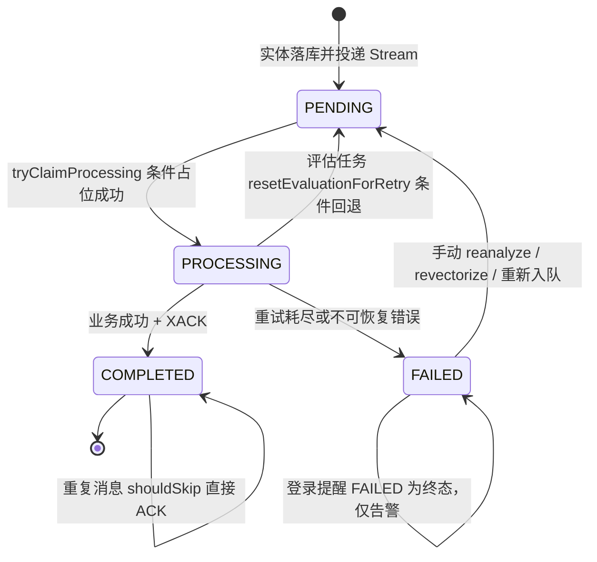

状态迁移由 `AbstractStreamConsumer.canTransitAsyncTaskStatus()` 约束：`COMPLETED` 是终态；`FAILED` 只能回到 `PENDING` 或保持 `FAILED`。

### 6.3 消费者处理流程

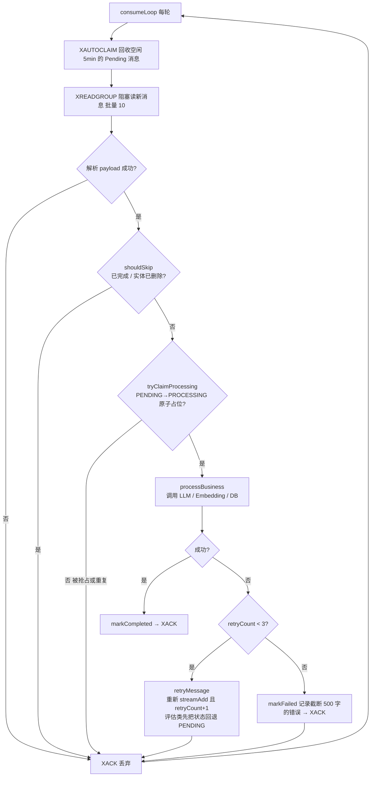

> **重要**：ACK 是**无条件**的（成功、失败、跳过、解析失败都 ACK），重试靠业务层重新投递消息，不依赖 Pending 重投；`XAUTOCLAIM` 只用于消费者宕机后的兜底回收。

---

## 7. 核心流程一：简历上传与异步分析

### 7.1 端到端时序

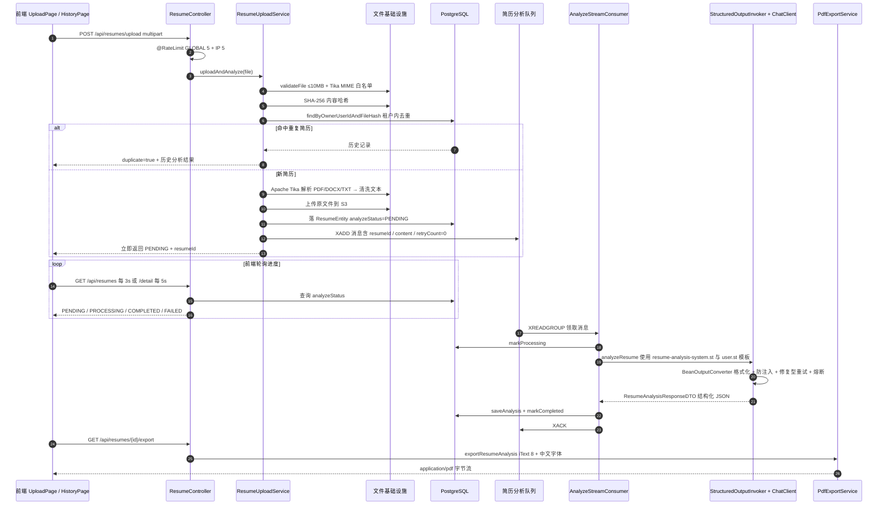

### 7.2 上传决策流程

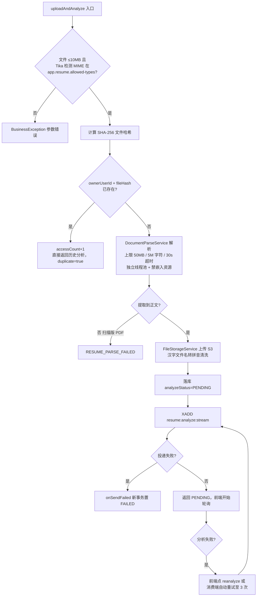

**分析输出结构**：`overallScore` + 5 项加权分（项目/技能匹配/内容各 25、结构 20、表达 15 中的对应维度）+ `summary` + `strengths[]` + `suggestions[]{category,priority,issue,recommendation}`。

---

## 8. 核心流程二：知识库与 RAG

### 8.1 文档上传与向量化

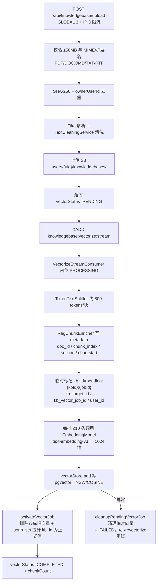

> **两阶段提交式向量替换**是本模块最值得讲的设计：先以 `pending:{kbId}:{jobId}` 写入，全部成功后再原子"提升"为正式 `kb_id` 并删除旧向量，避免重新向量化过程中出现空窗或新旧向量混检。

### 8.2 RAG 检索与问答生成

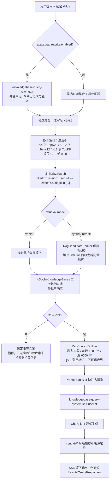

### 8.3 RAG 会话 SSE 时序

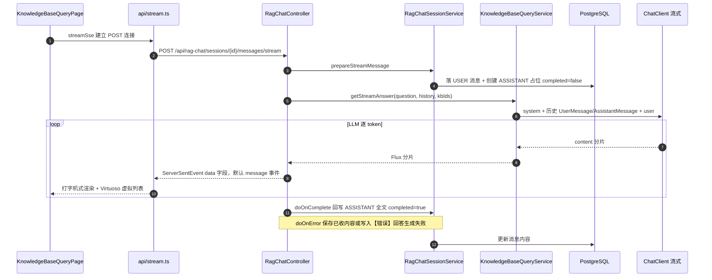

---

## 9. 核心流程三：模拟面试与统一评估

### 9.1 Skill 驱动出题流程

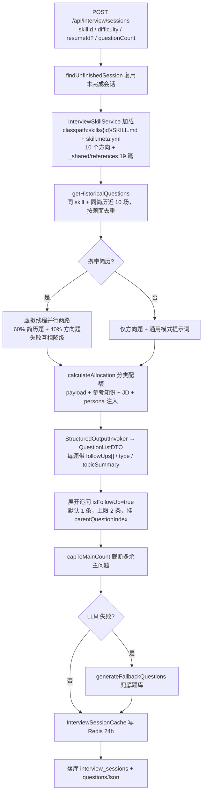

> **追问不是答题时动态生成的**：出题阶段每道主问题就自带 `followUps[]`，展开成带「（追问N）」分类的题目。文字面试没有阶段时长概念（只有题数 + 追问数），阶段时长是语音面试的能力。

### 9.2 文字面试会话状态机

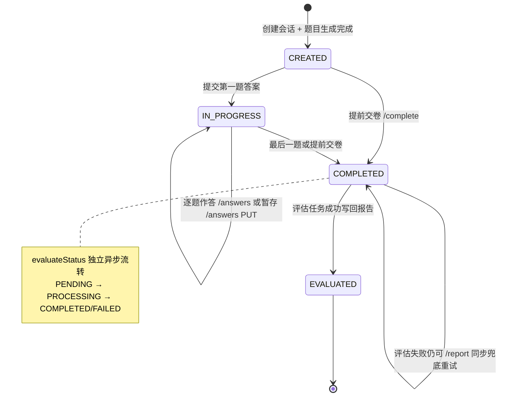

### 9.3 统一评估引擎时序

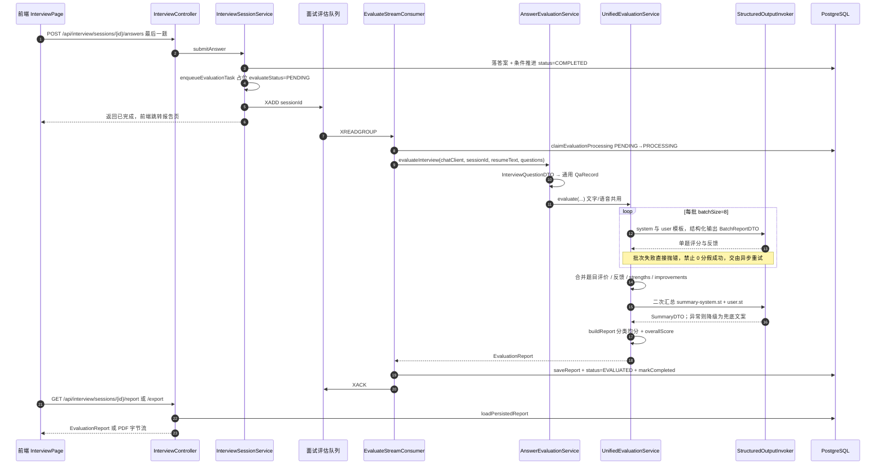

---

## 10. 核心流程四：实时语音面试

### 10.1 组件与协议架构

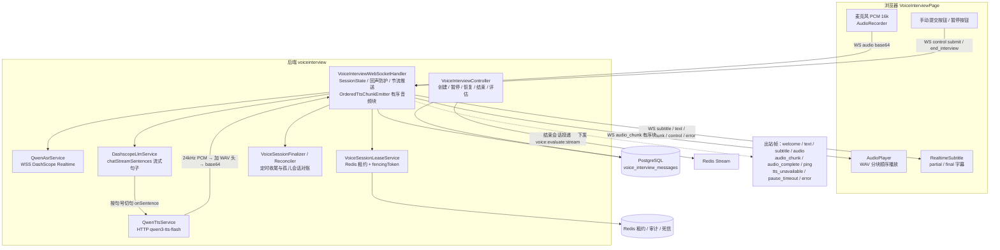

### 10.2 WebSocket 一次性票据握手

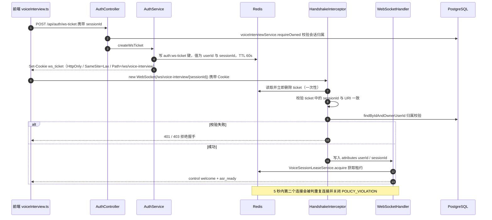

> 浏览器 WebSocket 不能自定义 Header，所以这里**不用 Bearer JWT**，改用一次性 Ticket Cookie + Redis 校验。

### 10.3 一轮对话时序

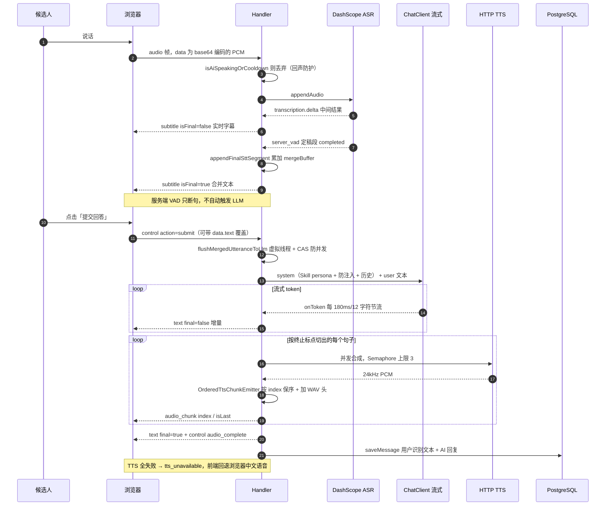

### 10.4 阶段与会话状态

阶段推进状态机：

```mermaid
stateDiagram-v2
  [*] --> INTRO : 创建语音会话
  INTRO --> TECH : 达到建议时长且题数达标或强制超时
  TECH --> PROJECT : 同上（projectEnabled 时）
  PROJECT --> HR : 同上（hrEnabled 时）
  HR --> COMPLETED : 阶段推进完成
  COMPLETED --> [*]
```

会话生命周期状态机：

```mermaid
stateDiagram-v2
  [*] --> IN_PROGRESS : 握手成功并建立租约
  IN_PROGRESS --> PAUSED : PUT /pause 或 5 分钟超时自动暂停
  PAUSED --> IN_PROGRESS : PUT /resume
  IN_PROGRESS --> FAILED : 异常或收尾失败
  IN_PROGRESS --> SESSION_COMPLETED : POST /sessions/id/end
  SESSION_COMPLETED --> [*]
  FAILED --> [*]
```

阶段时长（分钟）：INTRO 3/5/8、TECH 8/10/15、PROJECT 8/10/15、HR 3/5/8，每阶段另有最少/最多题数；`shouldTransitionToNextPhase` 按「强制超时 → 题数上限 → 建议时长 + 最少题数」三条规则判断。暂停/恢复走 **REST**，WebSocket 只下发 `pause_timeout_warning` / `pause_timeout` 通知帧。

---

## 11. 多模型 Provider 与 AI 治理

```mermaid
flowchart TB
  subgraph ENTRY["业务调用方"]
    B1["简历分析 / 出题 / 评估<br/>结构化输出"]
    B2["RAG 问答 / 语音面试<br/>流式输出"]
    B3["知识库向量化<br/>Embedding"]
  end
  subgraph CORE["AI 治理核心 common/ai"]
    REG["LlmProviderRegistry<br/>按 providerId 缓存并动态构建 ChatClient<br/>getDefault / getStructured / getVoice / reload"]
    SOI["StructuredOutputInvoker<br/>BeanOutputConverter.getFormat<br/>防注入指令 + 修复型重试 + 严格 JSON<br/>最多 structured-max-attempts=2 次"]
    CLF["AiCallClassifier<br/>PARSE / TRANSIENT / RATE_LIMIT / TIMEOUT<br/>AUTH / QUOTA / CLIENT / BUSINESS"]
    CB["AiCircuitBreaker<br/>连续故障阈值 5 / 熔断 30s / 半开探活"]
    SEC2["PromptSanitizer + ProviderEndpointValidator<br/>随机 data-boundary 分隔符 / SSRF 出站校验"]
    MET["Micrometer 指标<br/>app.ai.structured_output.* / app.ai.circuit.*"]
  end
  subgraph PROVIDERS["模型来源"]
    DBC["数据库 llm_provider_config<br/>API Key 密文 + nonce 加密"]
    YML["application.yml app.ai.providers<br/>dashscope / kimi / deepseek / glm / lmstudio"]
    GLOBAL["llm_global_setting<br/>默认 Chat / Embedding Provider（单例 id=1）"]
  end
  subgraph UPSTREAM["上游服务"]
    DS["DashScope OpenAI 兼容端点"]
    OTHER["Kimi / DeepSeek / GLM / LM Studio"]
    EMBM["text-embedding-v3 或 embedding-3<br/>1024 维"]
  end
  B1 --> SOI --> REG
  B2 --> REG
  B3 --> REG
  REG --> CB
  REG --> SEC2
  SOI --> CLF --> CB
  SOI --> MET
  DBC --> REG
  YML --> REG
  GLOBAL --> REG
  REG --> DS
  REG --> OTHER
  REG --> EMBM
```

**为什么排除自动配置**：`App.java` 显式排除 6 个 Spring AI OpenAI 自动配置类（Chat / Embedding / Audio 等），因为模型必须由 `LlmProviderRegistry` 依据数据库 + 配置的 Provider 动态构建，才能实现设置页切换默认模型、热加载 `/reload`。

**统一评估引擎** `common/evaluation/UnifiedEvaluationService` 是文字与语音的公共底座：分批评估（batch-size=8）→ 合并 → 二次汇总（失败降级兜底）→ 生成 `EvaluationReport`，因此两种面试的评估结果可直接对比。

---

## 12. 横切能力

### 12.1 限流

```mermaid
flowchart LR
  A["方法叠加多条 @RateLimit<br/>GLOBAL / IP / USER / PHONE"] --> B["RateLimitAspect @Around<br/>逐条执行，任一不过则拒绝"]
  B --> C["生成带 hash tag 的键<br/>ratelimit:{类:方法}:维度:标识"]
  C --> D["EVALSHA 执行 rate_limit_single.lua"]
  D --> E["滑动窗口：ZSET 记录已用令牌<br/>回收过期令牌 → 判断余额 → 扣减"]
  E --> F{"余额 ≥1?"}
  F -->|"是"| G["放行，全部规则通过才执行业务"]
  F -->|"否"| H{"配置了 fallback?"}
  H -->|"是"| I["反射调用同类降级方法"]
  H -->|"否"| J["RateLimitExceededException → 错误码 8001"]
```

典型规则：发验证码 `GLOBAL 100/1min + IP 10/1h + PHONE 1/60s`；简历上传 `GLOBAL 5 + IP 5`；知识库上传 `GLOBAL 3 + IP 3`；`parse-jd` `IP 5`。目前 `USER` 维度虽已定义但未实际标注。

### 12.2 资源删除补偿

```mermaid
flowchart TD
  A["删除简历 / 知识库请求"] --> B["同一事务内<br/>删业务数据 + 登记 resource_deletion_compensations(PENDING)"]
  B --> C["事务提交后 ResourceCleanupExecutor 触发<br/>ResourceCleanupRequestedEvent"]
  C --> D["清理 S3 原文件 + pgvector 向量"]
  D --> E{"成功?"}
  E -->|"是"| F["COMPLETED"]
  E -->|"否"| G["FAILED + 指数退避 nextAttemptAt<br/>RetryScheduler 定时重试"]
  G --> H{"超过最大次数?"}
  H -->|"是"| I["DEAD 死信告警"]
  H -->|"否"| D
  F --> J["每日凌晨 ResourceOrphanScanScheduler<br/>扫描对象存储与向量库孤儿，只告警不删除"]
```

这套机制解决的是"先删库，外部资源清理可能失败"的分布式一致性问题：补偿记录与业务删除同事务，保证不会静默丢失清理任务。

### 12.3 异常、监控与其他

- **统一响应**：`Result<T>{code,message,data}`；`GlobalExceptionHandler` 把业务异常、参数校验、上传超限、AI 网络异常兜底成统一结构（部分场景 HTTP 200 + 业务错误码）。
- **可观测性**：Actuator `health,info,metrics,prometheus`（prod 仅 `health`）；核心指标包括 `app.ai.structured_output.*`、`app.ai.circuit.*`、`rag.retrieval.*`、`rag.citation.*`、`app.voice.interview.{asr,llm,tts,turn}.*`。
- **定时任务**：登录提醒重试、资源清理重试、孤儿扫描、面试安排状态自动过期、语音会话心跳/超时暂停/孤儿对账/收尾重试。
- **Prompt 安全**：`PromptSanitizer` + 不可预测的 `<data-boundary-{uuid}>` 分隔符 + 防注入指令；RAG 上下文被明确标记为"不可信输入"。

---

## 13. 部署架构

### 13.1 生产编排

```mermaid
flowchart TB
  USER["浏览器"] -->|"http://localhost"| NG["frontend 容器 :80<br/>nginx:alpine<br/>/ → index.html SPA 回退<br/>/api/ → app:8080<br/>/ws/ → Upgrade 长连接"]

  subgraph COMPOSE["docker-compose.yml · 默认网络 · 4 个命名卷"]
    NG -->|"depends_on"| APP["app 容器 :8080<br/>eclipse-temurin:21-jre<br/>SPRING_PROFILES_ACTIVE=prod"]
    APP -->|"JDBC"| PG[("postgres pgvector/pgvector:pg16<br/>仅内网 · postgres_data")]
    APP -->|"Redisson"| RD[("redis:7<br/>仅内网 · redis_data")]
    APP -->|"S3 SDK"| MIN[("minio/minio :9000→9000<br/>minio_data")]
    INIT["createbuckets minio/mc<br/>Init Container：建 interview-guide 桶<br/>并设为私有"] -->|"service_completed_successfully"| APP
    MIN -.-> INIT
    APP --> LOG["app_logs 卷<br/>/app/logs 文件日志"]
  end

  APP -->|"HTTPS / WSS"| EXT["DashScope Chat / Embedding / ASR / TTS<br/>阿里云短信"]
  PG -->|"健康检查 pg_isready"| APP
  RD -->|"健康检查 redis-cli ping"| APP
  MIN -->|"健康检查 /minio/health/live"| APP
```

**关键端口与链路**：只有前端 `:80` 与后端 `:8080`、MinIO API `:9000` 映射到宿主机；PG/Redis 只在内网。前端 `nginx.conf` 的 `/ws/` 必须设置 `Upgrade` 与 `Connection: upgrade` 且 `proxy_read_timeout 3600s`，否则语音面试长连接会被断开；`/api/` 超时 300s 对齐大文件上传。

### 13.2 开发 vs 生产

| 项 | 本地开发 | 生产容器 |
| --- | --- | --- |
| 启动方式 | `./gradlew :app:bootRun` + `pnpm dev` | `docker compose up -d --build` |
| 依赖 | `docker-compose.dev.yml`：PG + Redis + **RustFS**，默认**不映射端口**（叠加 `dev.local.yml` 才有 5432 / 6380:6379 / 9000 / 9001） | PG + Redis + **MinIO** + `createbuckets` |
| 前端入口 | Vite `:5173` 代理 `/api`、`/ws` 到 8080 | Nginx `:80` 反代 |
| Profile | 默认（`CorsConfig` 生效、Swagger 开、`initialize-schema=true`） | `prod`：Swagger 关、`ddl-auto=validate`、CORS 强制真实域名、Cookie Secure、日志落文件 |
| 建表 | `ddl-auto: update`（可） | **Flyway** 管理；`PGVECTOR_INIT_SCHEMA=true` 仅首次建 `vector_store` |
| 短信 | Mock（验证码可直接调试） | 必须配置阿里云短信 |

### 13.3 配置来源与优先级

```mermaid
flowchart LR
  ENV[".env / 系统环境变量"] --> COMPOSE["docker-compose.yml environment"]
  COMPOSE --> YML["application.yml<br/>${VAR:default} 占位符"]
  YML --> PROD["application-prod.yml<br/>覆盖安全项，无默认值时快速失败"]
  PROD --> PROPS["@ConfigurationProperties 类<br/>AuthProperties / LlmProviderProperties<br/>StorageConfigProperties / VoiceInterviewProperties"]
  PROPS --> BEANS["Spring Bean<br/>CORS / S3 / Clock / EmbeddingModel"]
  DBP[("llm_provider_config<br/>llm_global_setting")] --> REG2["LlmProviderRegistry 运行时热加载<br/>/api/llm-provider/reload"]
  YML --> REG2
  REG2 --> BEANS
  VALID["ProductionConfigurationValidator<br/>启动前置校验密钥 / CORS / 加密配置"] --> PROD
```

> `bootRun` 会在 Gradle 任务里逐行读取根目录 `.env` 注入进程环境（Gradle 默认不读 `.env`），同时强制 JVM 使用 UTF-8。

---

## 14. 前端结构

### 14.1 路由与页面

```mermaid
flowchart TB
  ROOT["BrowserRouter App.tsx<br/>全部页面 lazy + Suspense"] --> LOGIN["/login LoginPage 公开"]
  ROOT --> GUARD{"ProtectedRoute<br/>无 user → /login"}
  GUARD --> LAYOUT["/ Layout 侧边栏"]
  LAYOUT --> G1["简历域<br/>/upload UploadPage<br/>/history HistoryPage<br/>/history/:id ResumeDetailPage"]
  LAYOUT --> G2["面试域<br/>/interview-hub InterviewHubPage<br/>/interview InterviewPage<br/>/interviews 历史与详情<br/>/voice-interview 语音面试与评估页<br/>/interview-schedule 日历页"]
  LAYOUT --> G3["知识库域<br/>/knowledgebase 管理<br/>/knowledgebase/upload 上传<br/>/knowledgebase/chat 问答助手"]
  LAYOUT --> ADMIN{"AdminRoute 非管理员 → /history"}
  ADMIN --> SETTINGS["/settings SettingsPage<br/>多模型与语音配置"]
  GUARD --> CATCH["* → 重定向 /history"]

  LAYOUT --> API["api/request.ts Axios 实例<br/>withCredentials + Bearer 注入<br/>Result 拆包 / Blob 下载 / 401 刷新"]
  G3 --> SSE["api/stream.ts SSE"]
  G2 --> WSAPI["api/voiceInterview.ts WebSocket"]
  API --> BACKEND["后端 /api/**"]
  SSE --> BACKEND
  WSAPI --> BACKEND
```

`frontend/src/constants/routes.ts` 是路由常量的唯一来源；页面全部懒加载，`vite.config.ts` 按 `react-vendor / ui-vendor / charts-vendor / markdown-vendor / syntax-highlighter` 做 manualChunks；RAG 聊天用 `react-virtuoso` 虚拟列表。

### 14.2 Access Token 刷新时序

```mermaid
sequenceDiagram
  autonumber
  participant FE as 任意页面
  participant AX as Axios 响应拦截器
  participant LOCK as navigator.locks 跨标签互斥
  participant BE as POST /api/auth/refresh
  participant SS as auth/session.ts

  FE->>AX: 发起 API 请求
  AX->>BE: 原请求返回 401
  AX->>LOCK: request ai-interview-auth-refresh 单例 refreshPromise
  LOCK->>BE: POST /api/auth/refresh 携带 refresh_token Cookie
  BE-->>LOCK: 新 accessToken + 轮换后的 Cookie
  LOCK->>SS: setAuthSession 并跨标签广播
  AX->>BE: 重放原请求（_retryAfterRefresh 防循环）
  BE-->>FE: Result 正常拆包
  Note over AX,SS: 刷新失败则 clearAuthSession 并跳转登录
```

---

## 15. 关键设计决策与事实校正

### 15.1 值得讲清楚的 7 个决策

| 决策 | 做法 | 换来了什么 / 代价 |
| --- | --- | --- |
| 不用独立向量库 | PG + pgvector，HNSW + COSINE + 1024 维 | 少一个组件、可同库事务；向量检索性能上限受 PG 约束 |
| 不用 Kafka | Redis Stream + 消费者组 + 生产者/消费者模板 | 运维简单、天然可跨语言扩展消费者；需自己实现幂等、重试、Pending 回收 |
| 动态多模型 | 排除 Spring AI 自动配置，自建 `LlmProviderRegistry` | 设置页可切默认模型、API Key 加密落库；需自行处理超时/熔断/SSRF |
| 结构化输出统一 | `StructuredOutputInvoker` + 修复型重试 + 分类 + 熔断 | 业务代码不重复重试逻辑；LLM 输出不稳定时仍能收敛成 JSON |
| 两阶段向量替换 | 先 `pending:jobId` 写入，再原子提升 | 重新向量化无空窗、不留半成品；多一次 `jsonb_set` 操作 |
| 语音走服务端中转 | WebSocket + ASR/LLM/TTS 均在后端 | 前端简单、密钥不暴露；端到端延迟偏高（README 已列为已知问题，TODO 计划 WebRTC） |
| 删除补偿事务 | 删库与补偿登记同事务，提交后异步清理 | 外部资源清理不丢任务；引入重试、死信与孤儿扫描的复杂度 |

### 15.2 容易画错 / 讲错的 8 个事实

1. **PDF 导出不是异步任务**：`GET /api/resumes/{id}/export` 与 `/api/interview/sessions/{id}/export` 都是**同步 HTTP** 返回字节流；Redis Stream 负责的是"生成评估/分析数据"，不是导出。全库只有 **5 组** Producer/Consumer、**5 条** Stream（含登录提醒），没有"报告导出"队列。
2. **SSE 没有自定义事件名**：`query/stream` 是 `Flux<String>`，`messages/stream` 是 `Flux<ServerSentEvent<String>>` 且只设置 `data(...)`，浏览器都按默认 `message` 事件接收。
3. **服务端 VAD 不自动触发 LLM**：DashScope `server_vad` 只产生 ASR 定稿段，真正触发面试官回复的是前端 `control{action:"submit"}`；`user-utterance-debounce-ms` 等 4 个 yml 项是**未被 Java 绑定的遗留配置**。
4. **WebSocket 鉴权不是 Bearer JWT**：是 `POST /api/auth/ws-ticket` 下发的一次性 `ws_ticket` Cookie + Redis 校验并立即删除。
5. **暂停/恢复走 REST**（`PUT /pause`、`/resume`），WebSocket 只有 `pause_timeout*` 通知帧。
6. **追问在出题时一次性生成**（主问题自带 `followUps[]`），不是答题过程中动态追问；**阶段时长只存在于语音面试**。
7. **ACK 无条件执行**，重试靠业务层重新 `XADD`（`retryCount+1`），`XAUTOCLAIM` 仅用于宕机兜底。
8. **生产用 MinIO、开发用 RustFS**；`docker/` 目录只有 `postgres/init.sql`，两个 Dockerfile 分别在 `app/Dockerfile`、`frontend/Dockerfile`，nginx 配置在 `frontend/nginx.conf`。

另外两个配置层面的小坑：`app.ai.rag.search.min-score-short` 在 `application.yml` 是 `0.18`，而 `KnowledgeBaseQueryProperties` 的 Java 字段兜底是 `0.25`（运行期以 yml 为准）；`app.voice-interview.rate-limit.*` 同样没有 Java 消费点，真正生效的是 `@RateLimit` AOP + Lua。

---

## 16. 源码索引（按图索骥）

| 想看什么 | 文件 |
| --- | --- |
| 启动与自动配置排除 | `app/src/main/java/interview/guide/App.java` |
| 异步框架 | `common/async/AbstractStreamProducer.java`、`AbstractStreamConsumer.java`、`common/constant/AsyncTaskStreamConstants.java` |
| AI 治理 | `common/ai/LlmProviderRegistry.java`、`StructuredOutputInvoker.java`、`AiCircuitBreaker.java`、`PromptSanitizer.java` |
| 统一评估 | `common/evaluation/UnifiedEvaluationService.java`、`InterviewEvaluationProperties.java` |
| 限流 | `common/annotation/RateLimit.java`、`common/aspect/RateLimitAspect.java`、`resources/scripts/rate_limit_single.lua` |
| 认证与租户 | `modules/auth/config/SecurityConfig.java`、`AuthService.java`、`security/CurrentUserService.java`、`resources/db/migration/V2__add_auth_and_tenant_ownership.sql` |
| 简历链路 | `modules/resume/ResumeController.java`、`service/ResumeUploadService.java`、`ResumeGradingService.java`、`listener/AnalyzeStreamConsumer.java` |
| RAG 链路 | `modules/knowledgebase/service/KnowledgeBaseVectorService.java`、`KnowledgeBaseQueryService.java`、`RagChatController.java`、`resources/prompts/knowledgebase-*.st` |
| 出题与 Skill | `modules/interview/service/InterviewQuestionService.java`、`skill/InterviewSkillService.java`、`resources/skills/*/SKILL.md` |
| 语音链路 | `modules/voiceinterview/handler/VoiceInterviewWebSocketHandler.java`、`service/QwenAsrService.java`、`QwenTtsService.java`、`DashscopeLlmService.java` |
| 前端 | `frontend/src/App.tsx`、`constants/routes.ts`、`api/request.ts`、`api/stream.ts`、`api/voiceInterview.ts` |
| 配置与编排 | `app/src/main/resources/application.yml`、`application-prod.yml`、`docker-compose.yml`、`frontend/nginx.conf` |
| 已有文档 | `docs/okmyj_总学习文档_七-十待看.md`（宏观架构）、`docs/voice-interview-architecture.md`（语音）、`docs/okmyj_sql_entity.md`（ER）、`docs/okauth-multitenancy-learning.md`（认证）、`AGENTS.md`（开发规约） |

---

*文档生成于 2026-11-09，内容以当前工作区源码为准；若后续重构了 Stream 数量、Provider 或部署形态，请同步更新本文对应图。*
